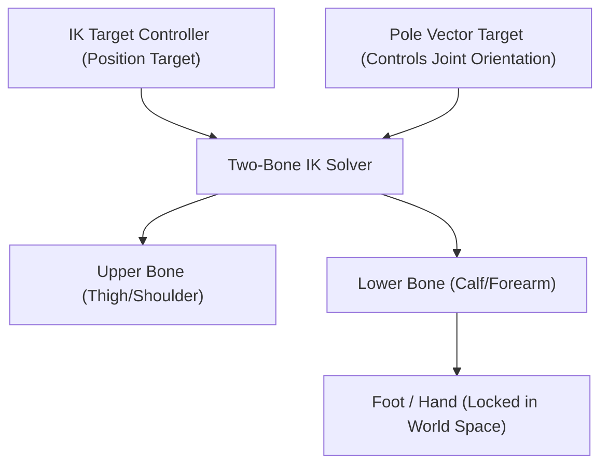

# 3D Animation, Skeletal Rigging & Cinematic Motion

This skill provides exhaustive methodologies for authoring lifelike character performances, kinetic motion design, and procedural camera animation.

---

## 1. Skeletal Kinematics & Rigging Architectures

### FK vs IK Mechanics
- **Forward Kinematics (FK)**:
  - Hierarchy: Parent bone rotations drive child bone positions ($T_{\text{child}} = T_{\text{parent}} \cdot R_{\text{parent}} \cdot T_{\text{local}}$).
  - Use case: Free-swinging motion (arms in walking/running cycles, tail swings, antenna wobbles).
- **Inverse Kinematics (IK)**:
  - Solver calculates joint angles based on an end-effector target location (e.g. hand or foot position).
  - Use case: Planted contact points (feet locked to ground terrain, hands pushing against a wall).
- **Pole Vectors & Elbow/Knee Flipping**:
  - Always assign an explicit Pole Target object $1\text{m}$ in front of knees and behind elbows to prevent 180-degree solver joint flips during extreme bends.

---

## 2. The 12 Principles of Animation: Mathematical Application

1. **Squash & Stretch**: Maintain constant volume ($V = X \cdot Y \cdot Z = \text{const}$). When $Z$ scales down to $0.80$, scale $X$ and $Y$ by $1 / \sqrt{0.80} \approx 1.118$.
2. **Anticipation**: Backward preparation gesture before forward action (e.g., crouching down before jumping up).
3. **Follow-Through & Overlapping Action**: Secondary elements (hair, clothing, capes) drag behind the main body and come to rest *after* the primary torso has stopped.
4. **Slow In & Slow Out (Easing)**: Cubic Bezier curve easing ($S$-curve in Graph Editor) to simulate physical inertia ($F = ma$).
5. **Arcs**: Natural motion follows circular or parabolic trajectories; linear translation feels robotic.

---

## 3. Graph Editor & F-Curve Engineering in Blender

When authoring procedural animation keyframes via `blender_execute_python`:
- Insert keyframes explicitly on transforms: `obj.keyframe_insert(data_path="location", frame=1)`.
- Set interpolation types:
  - `BEZIER`: Smooth natural movement with adjustable acceleration handles.
  - `LINEAR`: Constant speed (e.g., rotating wheels, laser beams).
  - `CONSTANT` (Step): Instant jump cuts or sprite-style cell animation.
- Cyclic loops: Add an `F-Curve Modifier` $\rightarrow$ `Cycles` for infinite walk cycles, breathing, and idle loops without copying thousands of keyframes.

---

## 4. Camera Trajectory & Generative Media Motion

For cinematic trailers and game cutscenes:
- Use **Damped Track** constraints to lock camera focus onto moving hero subjects while applying subtle rotational noise (Perlin noise on camera rotation) for organic hand-held realism.
- When generating cinematic video footage, interface with `media_generate_video` using specific camera motions:
  - `orbit_clockwise`: Dynamic 360-degree hero reveal.
  - `dolly_zoom` (Vertigo effect): Camera moves backward while focal length zooms in, creating visual disorientation.
  - `pan_left` / `pan_right`: Smooth horizontal tracking of fast-moving action.
