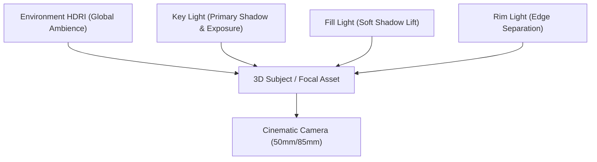

# 3D Design & Spatial Art Direction

This skill provides exhaustive methodologies for architecting high-fidelity 3D scenes, cinematic camera setups, and photorealistic or stylized visual environments.

---

## 1. Compositional Architecture & Camera Optics

### Camera Blocking & Sensor Mathematics
- **Focal Length Selection**:
  - `24mm - 35mm`: Wide architectural interiors, landscape vistas, environmental immersion (watch for barrel distortion near frame edges).
  - `50mm`: Human eye natural perspective; standard product visualization.
  - `85mm - 135mm`: Character portraits, hero game assets, compressed depth of field with cinematic bokeh.
- **Aspect Ratios**:
  - `16:9` ($1.78:1$): Standard widescreen for games, monitors, YouTube.
  - `21:9` ($2.39:1$): Anamorphic cinema; ultra-wide gaming.
  - `9:16`: Mobile vertical video feeds (Reels, TikTok, Shorts).
- **Rule of Thirds & Golden Ratio**: Place primary visual anchors at the intersection of thirds grid lines; use leading geometry lines to direct viewer eye gaze to the focal element.

---

## 2. Professional Lighting Architectures

### The 4-Tier Lighting Hierarchy
1. **Key Light**: Primary illumination source, placed $30^\circ - 45^\circ$ off-camera axis and slightly above subject. Sets scene exposure and primary shadows.
2. **Fill Light**: Soft, diffused light positioned opposite the Key light at $30\% - 50\%$ Key intensity to lift deep shadows without introducing secondary hard shadows.
3. **Rim / Back Light**: High-intensity backlight placed behind the subject to create an edge silhouette, optically separating the subject from the background.
4. **Environment / Ambient (HDRI)**: 32-bit floating-point radiance map providing natural sky reflections, global ambient bounce, and physically accurate ground bounce.

---

## 3. Color Management & PBR Aesthetics

- **Color Transforms**:
  - Always use **AgX** (Blender 4.0+) or **ACEScg** (Unreal Engine 5) rather than legacy sRGB. AgX prevents chromatic clipping and hue shifting in bright highlights (e.g. fire, specular glints).
- **Subsurface Scattering (SSS)**:
  - Essential for organic materials (skin, wax, foliage, marble) where light penetrates the surface and scatters internally.
- **Roughness & Specular Micro-Facet Modeling**:
  - Real-world surfaces are never $100\%$ rough or $100\%$ mirror-like. Use procedural noise textures with subtle roughness variations ($0.15 - 0.75$) to achieve believable surface tactile feel.

---

## 4. Blender & Unreal Engine Tool Integration

When generating 3D designs in Recode:
- Use `blender_create_mesh` and `blender_assign_material` for procedural asset synthesis.
- Use `unreal_spawn_actor` and `unreal_inspect_world` to compose live levels in Unreal Engine 5.
- Export production-ready assets to `.glb` / `.gltf` for web embeds and `.fbx` for engine imports.
