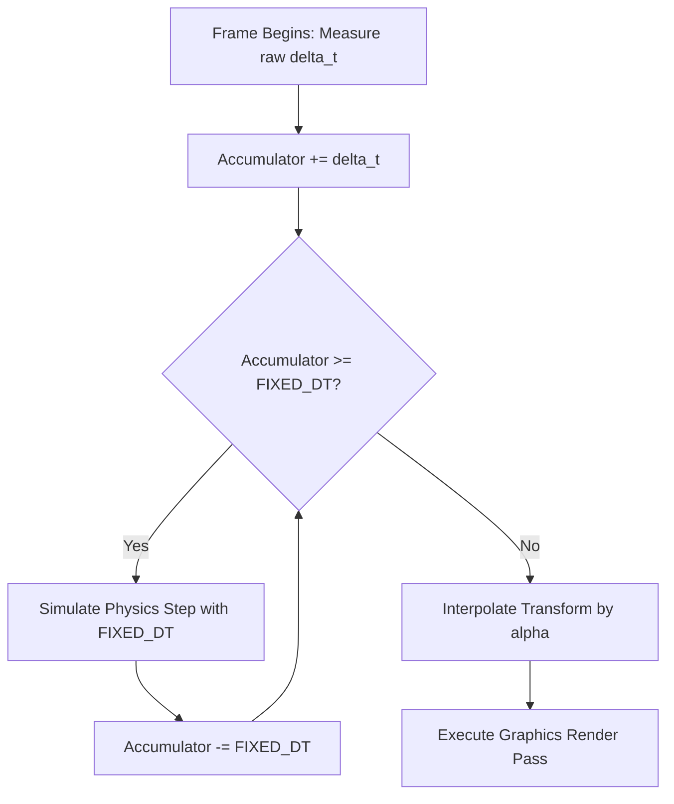

# Game Engine Architecture & Systems Engineering

This skill provides exhaustive patterns for architecting scalable, high-performance game systems across modern engines (Unreal Engine 5, Godot, Bevy, Three.js).

---

## 1. Deterministic Game Loop & Frame Timing

### The Semi-Fixed Timestep Pattern
Never update physics with variable $\Delta t$ (causes tunneling, floating-point drift, and non-reproducible behavior across hardware). Always decouple physics simulation from render frame rate using an accumulator:

$$\text{accumulator} += \Delta t_{\text{frame}}$$
$$\text{while } (\text{accumulator} \ge \Delta t_{\text{fixed}}) \implies \text{SimulatePhysics}(\Delta t_{\text{fixed}}), \quad \text{accumulator} -= \Delta t_{\text{fixed}}$$
$$\text{Render}(\alpha = \text{accumulator} / \Delta t_{\text{fixed}})$$

---

## 2. Entity Component System (ECS) vs Object-Oriented Hierarchies

For high-density simulations (thousands of projectiles, units, particle actors), avoid deep OOP inheritance trees (`Actor -> Pawn -> Character -> HeroCharacter`) which cause cache-thrashing pointer indirection.

### Data-Oriented Component Design
- **Entities**: Lightweight 64-bit integer IDs.
- **Components**: Pure Plain-Old-Data (POD) structs packed into contiguous arrays in memory (`Archetype` or `SparseSet`).
- **Systems**: Stateless functions iterating over matching component tuples in vectorized loops (SIMD-friendly).

---

## 3. Unreal Engine 5 Core Systems Architecture

### 1. Gameplay Ability System (GAS) & Gameplay Tags
- Encapsulate all player actions (spells, sprints, attacks, cooldowns) into `UGameplayAbility` instances.
- Use hierarchical `GameplayTags` (`State.Debuff.Stunned`, `Ability.Melee.Heavy`) rather than brittle boolean flags.
- Replicate attributes (`Health`, `Mana`, `Shield`) via `UAttributeSet` with server-side validation.

### 2. Remote Automation via Recode
- Use `unreal_execute_python` to script asset compilation and levels.
- Use `unreal_spawn_actor` to inject Blueprints, lights, and gameplay volumes into the active scene.
- Use `unreal_inspect_world` to audit level hierarchy and verify collision bounds.

---

## 4. Authoritative Multiplayer Networking

### The 4 Pillars of Multiplayer Synchronization
1. **Server Authority**: The server is the single source of truth; clients send *inputs* (keystrokes, angles), never authoritative positions or hit results.
2. **Client-Side Prediction**: The client immediately applies local player input to its local character to guarantee 0ms responsive feedback.
3. **Server Reconciliation**: When authoritative server snapshots arrive, if predicted position diverges beyond tolerance ($\epsilon > 0.05\text{m}$), snap local state and replay unacknowledged inputs.
4. **Entity Interpolation**: Smoothly render remote players $100\text{ms}$ in the past using a circular snapshot buffer to eliminate jitter over unstable packet arrival times.
