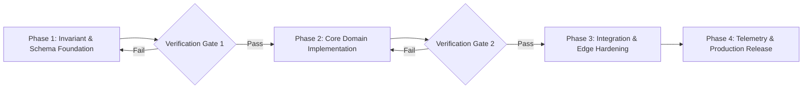

# Strategic Technical Planning & Systems Architecture

This skill provides exhaustive methodologies for architecting complex software initiatives, decomposing large-scale technical problems, and creating rigorous Architectural Decision Records (ADRs).

---

## 1. Architectural Decision Record (ADR) Standard

Document non-trivial technical choices using the structured Michael Nygard ADR format:

```markdown
# ADR-001: Adoption of New Database Sharding Strategy

## Status
Accepted (Date: 2026-11-10)

## Context
Our relational PostgreSQL cluster is approaching 85% disk I/O capacity during peak load. 
Vertical scaling provides diminishing returns. We require an architecture capable of supporting 
a 5x throughput increase over the next 18 months while maintaining sub-50ms p99 query latency.

## Decision
We will implement horizontal range-based sharding partitioned by Organization UUID, utilizing 
Citus/PgBouncer connection pooling. 

## Consequences
### Positive:
- Storage and write throughput scale linearly with shard node additions.
- Shards can be isolated and backed up independently.
### Negative:
- Cross-shard joins are disabled; queries aggregating across organizations must be 
  denormalized or handled via the analytics data warehouse.
- Application layer must maintain shard-routing keys on every database session.
```

---

## 2. Failure Mode and Effects Analysis (FMEA)

Before executing high-risk migrations or feature launches, calculate Risk Priority Numbers (RPN):

$$\text{RPN} = \text{Severity } (1-10) \times \text{Occurrence } (1-10) \times \text{Detection Difficulty } (1-10)$$

| Component | Potential Failure Mode | Potential Effect | S | O | D | RPN | Mitigation Action |
|---|---|---|---|---|---|---|---|
| Database Migration | Schema lock timeout | API downtime | 9 | 4 | 3 | **108** | Use `CONCURRENTLY` index creation with 5s lock timeout |
| Auth Token Rotation | Clock drift mismatch | User mass logout | 8 | 3 | 4 | **96** | Implement 60s leeway window on token expiration check |
| Edge Function Cache | Stale cache stampede | DB connection pool exhaustion | 9 | 3 | 5 | **135** | Implement XFetch early probabilistic revalidation |

*Actions are mandatory for any item with RPN $> 100$ or Severity $= 10$.*

---

## 3. Phased Execution Dependency Blueprints

Decompose initiatives into strictly decoupled phases with explicit entry and exit gates:



### Critical Rules for Execution Planning:
1. **Never Ship Breaking Schema with New Logic in Single Deploy**: Follow the Expand-Contract pattern (Expand: Add new column nullable $\rightarrow$ Deploy code writing both $\rightarrow$ Backfill old rows $\rightarrow$ Contract: Remove old column).
2. **Deterministic Rollback Plan**: Every deployment phase must document an automated, tested single-command rollback procedure that requires zero manual database surgery.

---

## 4. Planning Checklist

- [ ] **Decoupled Workstreams**: Are tasks organized so that independent modules can be built and tested in parallel?
- [ ] **Failure Blast Radius**: Is the blast radius bounded (e.g., behind feature flags or staged rollouts)?
- [ ] **Observability Verification**: Are metric counters, error alerts, and latency percentiles defined before writing code?
