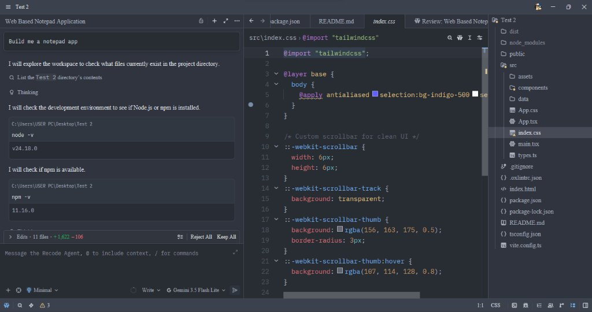
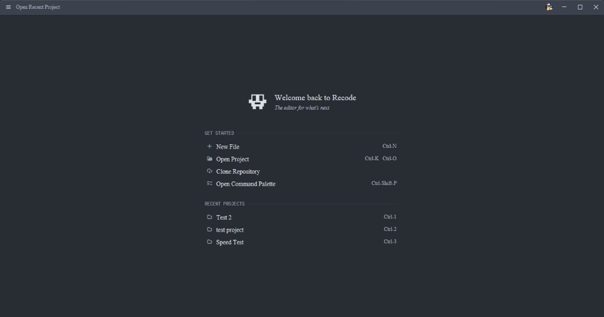

# Recode

<p align="center">
  
</p>

<p align="center">
  <strong>The Autonomous AI Code Editor. Built for Speed, Multi-Model Precision, and Native GPU Performance.</strong>
</p>

<p align="center">
  <a href="https://github.com/Fortunehack45/Recode/releases"></a>
  <a href="LICENSE.md"></a>
  
  
  
</p>

---

## Overview

**Recode** is an open-source, native, GPU-accelerated code editor engineered in pure Rust. It combines instantaneous cold boot speeds (<50ms) and silky 120 FPS rendering with a deeply integrated autonomous AI coding agent, multi-file diff engine, full Model Context Protocol (MCP) ecosystem, and Bring Your Own Key (BYOK) privacy.

<p align="center">
  
  <br />
  <em>Recode in action: Autonomous AI Agent orchestrating multi-file project edits, executing terminal tool calls, and inspecting Tailwind CSS in a GPU-accelerated workspace.</em>
</p>

---

## ✨ Key Features

### 🤖 Autonomous AI Agent & Bring Your Own Key (BYOK)
- **Multi-Model Orchestration**: Connect seamlessly to Anthropic Claude (3.5 Sonnet, Opus), OpenAI (GPT-4o, o1, o3-mini), Google Gemini (2.5 Pro, Flash Lite), DeepSeek (V3, R1), or local models via Ollama and LM Studio.
- **True BYOK Freedom**: Input your own API keys directly. Your queries and code stay between your machine and your chosen AI provider with zero middleman markup, tracking, or rate-limiting.
- **Autonomous File & Terminal Operations**: The Recode Agent can explore project file trees, execute terminal commands (`node`, `npm`, `cargo`, `git`), create and edit multiple files concurrently, and present clean atomic diffs for 1-click review (`Keep All` / `Reject All`).
- **Flexible Modes**: Switch between **Write** (autonomous multi-file editing) and **Chat** (conversational codebase exploration) on the fly.

### ⚡ Blazing Native Performance (Zero Electron Overhead)
- **Engineered in Rust with GPUI**: Every pixel is rasterized directly on your GPU with Metal, DirectX, and Vulkan backends.
- **Sub-50ms Launch**: Opens immediately without splash screens or background warmup delays.
- **Minimal Resource Footprint**: Consumes only ~45–50MB of RAM at idle compared to 500MB–1GB+ in Chromium-based editors.

### 🧩 Extension Marketplace & Model Context Protocol (MCP)
- **Extensible Ecosystem**: Access 100+ community extensions directly from the in-app Marketplace, including language servers (Rust, TypeScript, Python, Go, PHP, Java, C/C++), themes, and icon packs.
- **First-Class MCP Integration**: Connect external tools, databases, and services to your AI agent using the standard Model Context Protocol (MCP) — Code Runner, MySQL, PostgreSQL, SQLite, Fetch, GitHub, and custom MCP servers.

### 🎨 Clean, Focused Workspace & Typography
<p align="center">
  
  <br />
  <em>Recode Welcome Launcher: Fast access to recent projects, command palette, and 1-click Git repository cloning.</em>
</p>

- **Custom-Tailored Typography**: Features custom-engineered default typography (**Recode Mono** and **Recode Sans**) alongside complete support for all system and Nerd Fonts.
- **Integrated Git Workflow**: Built-in visual branch indicators, file status diffs, commit timelines, and instant Git repository cloning.
- **Real-Time Multiplayer Collaboration**: Pair program with colleagues over CRDT-backed real-time synchronized buffers with voice and screen sharing.

---

## 🚀 Installation & Downloads

Official pre-built binary packages are published for every release:

| Platform | Package | Description |
| :--- | :--- | :--- |
| **Windows x64** | [**RecodeSetup-x64.exe**](https://github.com/Fortunehack45/Recode/releases/latest/download/RecodeSetup-x64.exe) | **Recommended.** 1-click installer with desktop & Start menu shortcuts, Explorer context menu ("Open with Recode"), and in-app auto-update. |
| **Windows x64** | `Recode-windows-x64-portable.zip` | Standalone portable archive. Zero installation required. |
| **macOS Apple Silicon** | `Recode-macos-arm64.zip` | Native universal binary for Apple Silicon (M1/M2/M3/M4). |
| **Linux x64** | `Recode-linux-x64.tar.gz` | Standalone tarball for modern Linux distributions. |

---

## 💻 Recode Terminal & Recode SDK

In addition to the GPU-accelerated desktop editor, Recode includes **Recode Terminal** (`@recode/cli`) and the **Recode SDK** (`@recode/sdk`), inspired by modern agentic architectures.

```text
╭─ ◆ Recode Terminal v1.30.0 ──────────────────────────────────────────╮
│  Autonomous AI Software Engineering Terminal                         │
│                                                                      │
│  📁 Workspace:  Ai ide (C:\Users\USER PC\Desktop\Ai ide)             │
│  ⚡ Model:      gemini-2.5-flash                                      │
│  🛡 Mode:       ⚡ Build (full read, write, and command execution)    │
│  👤 Account:    ○ Not signed in (run /login)                         │
│  🌐 Collab:     ● Connected wss://recode-collab.fly.dev/rpc          │
│                                                                      │
│  Commands:   /connect  /models  /login  /mode  /clear  /help  /exit  │
╰──────────────────────────────────────────────────────────────────────╯
```

### 1. Recode Terminal CLI (`@recode/cli`)

Run an autonomous coding agent directly inside your terminal with real-time streaming, interactive multi-provider setup, `@file` context tagging, inline shell execution (`!cmd`), and file diffing.

```bash
# Run immediately without installation
npx @recode/cli

# Or install globally with pnpm/npm
npm install -g @recode/cli

# Launch interactive terminal assistant
recode

# Connect your preferred AI key (Gemini free tier, OpenAI, Claude, DeepSeek, Groq, or Ollama)
recode /connect

# Headless command execution (for scripts and CI/CD)
recode run "Inspect auth module, add unit tests, and run test suite"

# Check authentication and model providers
recode auth status

# Authenticate with GitHub (Device Flow - zero passwords, zero email)
recode auth login

# List available models
recode models
```

#### Interactive Terminal Features (OpenCode Architecture)
- **`/connect`**: Multi-provider interactive setup card. Zero vendor lock-in: use Google Gemini (free tier), OpenAI, Anthropic, DeepSeek, Groq, or local offline Ollama.
- **`/mode`**: Toggle between **Build** mode (autonomous file edits & command execution) and **Plan** mode (read-only architectural planning).
- **`@<path>`**: Attach any file or folder context directly into your prompt.
- **`!<cmd>`**: Execute inline terminal shell commands (e.g. `!git status` or `!cargo test`).
- **`/login`**: Pure developer GitHub Device Flow authentication (no email or password requirements).

#### Pure Developer Authentication (Zero Email)
Recode Terminal strictly avoids Gmail, passwords, or magic links. It uses:
- **GitHub Device Code Flow**: Instant one-click browser approval (`recode auth login`)
- **GitHub Personal Access Tokens (PAT)**: For headless server/container environments
- **BYOK Provider API Keys**: `ANTHROPIC_API_KEY`, `OPENAI_API_KEY`, `GEMINI_API_KEY`, `DEEPSEEK_API_KEY`, or local Ollama.

---

### 2. Recode SDK (`@recode/sdk`)

Programmatically orchestrate Recode's autonomous coding agent in your TypeScript/JavaScript projects, bots, or CI automations:

```bash
pnpm add @recode/sdk
```

```typescript
import { Recode, RecodeAuth } from "@recode/sdk";

// Initialize Recode client
const recode = new Recode({
  provider: "anthropic",
  model: "claude-3-7-sonnet",
  workspaceDir: process.cwd(),
});

// Create an interactive session
const session = recode.createSession();

// Stream autonomous reasoning, file operations, and token chunks
for await (const event of session.prompt("Refactor database schema to support vector embeddings")) {
  if (event.type === "token") {
    process.stdout.write(event.content);
  } else if (event.type === "tool_start") {
    console.log(`\n[Tool Executing] ${event.toolCall.name}`);
  } else if (event.type === "tool_end") {
    console.log(`[Tool Complete] Success: ${event.toolResult.success}`);
  }
}

// Or execute a prompt headlessly to completion:
const result = await recode.run("Run linting and fix format errors");
console.log(result);
```

---

## ⚙️ Configuration & Customization

Recode stores user settings in standard JSON format located at `~/.config/recode/settings.json` (or `%APPDATA%\Recode\settings.json` on Windows).

### Example Configuration: Bring Your Own API Key & MCP

```json
{
  "theme": "Recode Dark",
  "buffer_font_family": "Recode Mono",
  "buffer_font_size": 15.0,
  "ui_font_family": "Recode Sans",
  "ui_font_size": 16.0,
  "language_models": {
    "google": {
      "api_key": "YOUR_GEMINI_API_KEY"
    },
    "anthropic": {
      "api_key": "YOUR_ANTHROPIC_API_KEY"
    },
    "openai": {
      "api_key": "YOUR_OPENAI_API_KEY"
    },
    "ollama": {
      "api_url": "http://localhost:11434"
    }
  },
  "context_servers": {
    "code-runner": {
      "command": "mcp-server-code-runner"
    }
  }
}
```

---

## 🛠️ Building from Source

### Prerequisites
- [Rust](https://rustup.rs/) (stable channel, 1.85+)
- Git
- Platform Build Tools:
  - **Windows**: Visual Studio 2022 C++ Build Tools
  - **macOS**: Xcode Command Line Tools
  - **Linux**: `libasound2-dev`, `libfontconfig1-dev`, `libwayland-dev`, `libxkbcommon-dev`

### Build Steps

```bash
# Clone the repository
git clone https://github.com/Fortunehack45/Recode.git
cd Recode

# Build the optimized release binary
cargo build --release --package recode --package cli

# Run the compiled Recode binary
./target/release/recode
```

---

## 📄 License & Open Source Community Model

Recode is **Open Source Software** licensed under **GNU General Public License v3.0 or later (`GPL-3.0-or-later`)** ([`LICENSE-GPL`](LICENSE-GPL)) for the editor application and **Apache License 2.0 (`Apache-2.0`)** ([`LICENSE-APACHE`](LICENSE-APACHE)) for designated framework and SDK crates, as summarized in [`LICENSE.md`](LICENSE.md).

- **Trademarks & Official Brand Protection:** Under GPL-3.0 Section 7(e) and Apache-2.0 Section 6, modified or third-party redistributions must replace Recode names, logos, and icons; see [`legal/TRADEMARK_POLICY.md`](legal/TRADEMARK_POLICY.md).
- **Contributor Agreement (CLA):** See [`legal/CONTRIBUTOR_LICENSE_AGREEMENT.md`](legal/CONTRIBUTOR_LICENSE_AGREEMENT.md).
- **Terms of Use:** See [`legal/terms.md`](legal/terms.md).
- **Privacy Policy:** See [`legal/privacy-policy.md`](legal/privacy-policy.md).
- **Official Repository & Releases:** [https://github.com/Fortunehack45/Recode](https://github.com/Fortunehack45/Recode) | [legal@recode.dev](mailto:legal@recode.dev)
